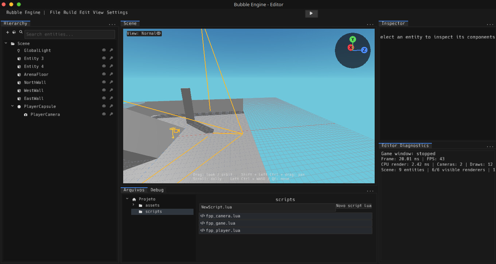

# Bubble Engine




[](https://github.com/D4nielStone/cpp-bengine/actions/workflows/build_and_test.yml)
[](https://github.com/D4nielStone/cpp-bengine/releases/latest)
[](https://github.com/D4nielStone/cpp-bengine/stargazers)
# About

An experimental C++ engine for windowing, rendering, physics, and component-based entities. The project is still under development and provides both runtime and editor applications.

# GUI

The engine uses Bubble GUI to provide a simple and easy-to-use interface for the editor application. The GUI supports native docking and windowing.

The engine bundles Hack Nerd Font for consistent, antialiased interface text.
BGUI's bundled 3270 Nerd Font has an intentionally pixelated terminal style, so
it remains dedicated to icon glyphs.

The engine also uses the BGUI API to build its own transform gizmos.

The editor's **Files** menu saves and loads the dock layout through BGUI in
`editor-ui.cfg`. Project settings and the main-scene reference live in
`project.bengine`; entity/component data lives in the referenced `.scene` file.
The **Edit** menu and `Ctrl+Z` / `Ctrl+Y` (or `Ctrl+Shift+Z`) undo and redo
scene edits, including Inspector changes, entity and component creation or
removal, and transform-gizmo drags. Loading another project clears this history.
Scene files support transforms, renderers, cameras, directional lights,
physics bodies/colliders, and Lua code components; saving fails with an error if
an entity contains a component without project serialization support. The
editor's Inspector panel is docked on the right and lets you edit transform,
camera, and directional-light properties, as well as add or remove supported
components. Selecting an entity in either the scene or the entity list updates
the Inspector.

The **Arquivos** panel shows the project folders on a dark sidebar and the
selected folder's files beside it. Selecting a `.world`, `.bengine`, or `.scene`
file reveals the option to make it the main scene; this choice is stored in
`.bengine-main-scene` at the project root. Drag supported 3D model files from
the panel into the Scene viewport to add them as entities.

Use the editor's centered play icon to open the current scene in a separate
runtime window. The icon sits in a dark toolbar container. The runtime window
displays the game camera framebuffer, along with frame time, FPS, CPU render
time, and draw counts. Press the stop icon in the editor to close the runtime
window. The **Editor Diagnostics** panel continues to show metrics for the
editor viewport.

# Dependencies

The editor's **Browse** buttons use the system file/folder dialog. On Linux,
install `zenity` or `kdialog` (for example, `sudo apt-get install zenity`).
On Windows the editor uses the built-in Explorer dialog. The Files panel
continues to show project assets inside the editor.

The following dependencies must be installed:

- CMake 3.20 or higher

- A compiler with C++20 support

- Lua 5.3

- GLFW

- GLM

- Assimp

- FreeImage

- FreeType

- Bullet

> The sol2, rapidjson, and glad libraries are maintained in the repository or included as submodules. 

When cloning the project, initialize them with:
```
git submodule update --init --recursive
```

# Building

From the project root, build both executables on Linux:
```
./scripts/build.sh
```

On Windows, run the PowerShell build helper:
```powershell
.\scripts\build.ps1
```

Both helpers configure and build the editor and runtime in `build/` by default.
Pass a build directory to use another location. Add `--test` on Linux or
`-RunTests` on Windows to also build and run the test suite.

## Documentation

The [documentation index](docs/README.md) links to the engine guides and
reference pages. The [Lua API reference](docs/lua-api/README.md) covers the
registered runtime bindings, script lifecycle, Inspector properties, and
current limitations.

For performance measurements, use an optimized build with debug symbols:

```sh
cmake --preset performance
cmake --build --preset performance --target editor_app runtime_app editor_render_tests
ctest --preset performance -R EditorRenderTest
./out/performance/apps/editor_app
```

This uses a separate build directory and leaves existing Debug builds intact.
The preset uses Unix Makefiles; on Windows, configure with the native generator
and `-DCMAKE_BUILD_TYPE=RelWithDebInfo` (or build `--config RelWithDebInfo`
with a multi-configuration generator).

Automated UI stress tests and per-release performance reports are described in
[docs/BENCHMARKS.md](docs/BENCHMARKS.md).

Once the editor is open, select **Build > Export Game**. Export saves the
current project/scene and produces a ready-to-run game for the selected target.
Choose a dedicated empty output directory; it will contain only `linux/` and/or
`windows/` game folders. An existing exported game is replaced only after the new
package is complete. Unrelated files are never deleted to make room for a build.

Each game folder contains the executable (named after the project folder),
`game.json`, `game/` with the project, scenes, Lua scripts and assets, and `assets/`
with the engine's bundled resources. Windows DLLs accompany the executable;
Linux shared dependencies are bundled in `lib/`. Launch the executable directly,
from any working directory: it locates `game.json` and opens the main scene.
No `--project` argument or source checkout is required for the exported game.

Enable **Single executable** in the export dialog to put compressed game assets
inside the executable. Scenes, Lua scripts, models, images, fonts and shaders are
read directly from it and decompressed in memory; no temporary game files are
extracted. This format requires a runtime with static game dependencies. Linux
still uses the host's graphics drivers, display libraries and compatible glibc.
Exported games hide profiling and collision debug overlays in both formats;
the development runtime retains them. Packaging discourages casual editing but
is not encryption or protection against a determined person extracting assets.

Exports first reuse a compatible precompiled runtime template. The editor ships
its host packager beside its executables. Templates are keyed by runtime sources,
platform and format, and cached outside the output folder. If none matches, the
runtime is compiled once and cached for subsequent projects. Supply an optional
**Runtime template** folder in the dialog to require a specific template; an
incompatible template fails instead of silently rebuilding. Distribute templates
under `export_templates/<linux|windows>/<folder|single>/<key>/` beside the engine
sources, or set `BENGINE_EXPORT_TEMPLATES`; override the writable cache with
`BENGINE_TEMPLATE_CACHE`.

For single-file CLI exports, append workspace, format, optional template and host
packager arguments to the shell command, for example:

```sh
sh scripts/platform_build.sh linux "$PWD" /path/to/export /tmp/game.progress /path/to/project.bengine /tmp/game-work single "" /path/to/game_packager
```

PowerShell accepts `-Format single`, `-RuntimeTemplate` and `-Packager`.
`BENGINE_PACKAGER` can also select the precompiled host packager. Without one,
the CLI builds that small tool first (including its zlib dependency).

CMake files, object files, dependency downloads, logs and progress stay in the
build cache, outside the output directory. The editor reports the log path.
The default output is `<editor-build-directory>/exports`.

All project resources are included, with their directory structure and model
sidecars (MTL, glTF buffers/textures and import settings). Editor layout,
previews, version control, development sources and build artifacts are excluded.
Absolute project paths become package-relative paths; built-in primitive assets
are included automatically. External assets and linked directories must be
imported into the project first. Lua code must use portable project-relative
resource references; dynamically constructed external paths cannot be inferred
by the exporter. Non-text model formats should be imported with relative/embedded
dependencies before export.

| Host | Linux x64 target | Windows x64 target |
|---|---|---|
| Linux x64 | Native host compiler and installed libraries | Zig/MinGW cross compilation with vcpkg |
| Windows x64 | Native Linux build inside the default WSL2 distribution | Native MSVC (Visual Studio 2022 C++ tools) and vcpkg; no WSL required |

Android is not supported in this phase. Native Windows builds require CMake,
Git, Visual Studio 2022 with Desktop development with C++, and the Windows SDK.
`VCPKG_ROOT` may point to an installed vcpkg checkout; otherwise the Windows
helper prepares it under `%LOCALAPPDATA%/cpp-bengine/toolchains`.
Runtime DLLs are copied alongside the Windows executable.

Linux native builds do not download Zig or vcpkg. Install requirements in
Linux (or inside the default WSL2 distribution for Windows → Linux):
```sh
sudo apt-get update
sudo apt-get install -y cmake build-essential pkg-config libgl1-mesa-dev \
  libglfw3-dev libglm-dev xorg-dev libxinerama-dev libxcursor-dev libxrandr-dev libxi-dev \
  libglu1-mesa-dev libassimp-dev libbullet-dev libfreetype6-dev \
  liblua5.3-dev libpng-dev
```

The Linux → Windows cross build downloads pinned Zig and PowerShell host tools as needed,
plus a pinned vcpkg release into the user cache to prepare target dependencies.
Windows cross-builds on Linux also download the MinGW-w64 resource compiler
with `apt-get download` (no root access); Debian/Ubuntu-based hosts need
`apt-get` and `dpkg-deb`. On other Linux distributions, install the
`x86_64-w64-mingw32-windres` tool from the distribution's MinGW-w64 binutils
package and ensure it is on `PATH`. Set `VCPKG_ROOT` to an existing vcpkg
checkout to reuse it instead.

The GitHub Actions workflow builds/tests the engine natively and exports a
Windows game both on Windows and from Linux. The remote workflow must run to
validate those platforms. Linux packages require a compatible glibc system and
the host's graphics drivers/OpenGL stack; this is a folder export, not an AppImage.

For command-line game export (compilation intermediates stay in the cache):
```sh
sh scripts/platform_build.sh linux "$PWD" /path/to/export /tmp/game-build.progress /path/to/project.bengine
sh scripts/platform_build.sh windows "$PWD" /path/to/export /tmp/game-build.progress /path/to/project.bengine
```
```powershell
./scripts/platform_build.ps1 -Target windows -RepositoryRoot "$PWD" -BuildDirectory C:/Games/Export -ProgressFile "$env:TEMP/game-build.progress" -ProjectFile C:/Projects/MyGame/project.bengine
```
The `compile_runtime.*` helpers are internal compilation steps, not game exports.

Run either application with:

```
./out/apps/runtime_app
./out/apps/editor_app
```

To open a scene directly in the editor, pass its file path with `--project`:

```
./out/apps/editor_app --project game.world
```

The editor's **Load Project** and **Save Project** menu actions use the same
path supplied at startup. Without `--project`, they continue to use
`project.bengine`. The **Load Project** action now opens a modal that accepts
a project directory or a project file path, and it resolves common folders such
as `project.bengine`, `game.world`, or a project directory containing one of
those files. Older `.bengine` files that still embed entities remain loadable.

The repository does not bundle a sample game or third-party game assets. Use
**New Project** in the editor to create an empty project or the built-in FPP
template, which includes example movement scripts. To export a game, pass your
own project's `.bengine` file to the platform build helper.

# Structure

> commons/: Reusable static library containing the engine's core functionality.

> apps/: Runtime and editor applications that use the engine.

> external/: Third-party dependencies included in the project.

# Installing

To install the library and headers to a specific prefix, run:

```
cmake --install out --prefix install
```

A iluminação direcional oferece sombras em tempo real (shadow mapping com PCF,
resolução padrão 2048² ajustável de 128 a 8192 no Inspector), controles **Cast Shadows / Receive Shadows** no Renderer e ajustes de
alcance, bias e intensidade no Inspector e em Lua. Veja os exemplos em
[API Lua](docs/LUA_API.md#sombras-em-tempo-real).
