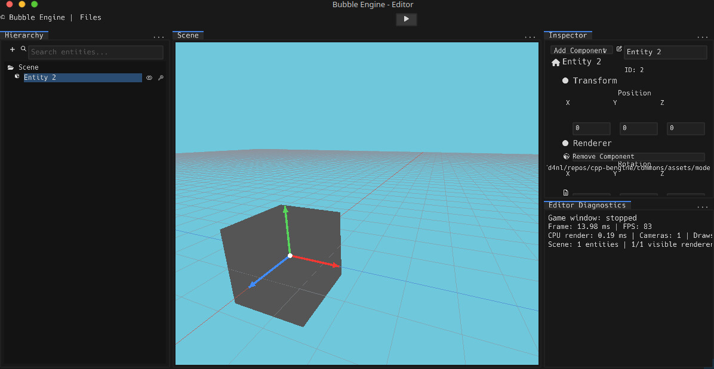

Bubble Engine
===



# About

An experimental C++ engine for windowing, rendering, physics, and component-based entities. The project is still under development and provides both runtime and editor applications.

# GUI

The engine uses Bubble GUI to provide a simple and easy-to-use interface for the editor application. The GUI supports native docking and windowing.

The engine bundles Hack Nerd Font for consistent, antialiased interface text.
BGUI's bundled 3270 Nerd Font has an intentionally pixelated terminal style, so
it remains dedicated to icon glyphs.

The engine also uses the BGUI API to build its own transform gizmos.

The editor's **Files** menu saves and loads the dock layout through BGUI in
`editor-ui.cfg`, and saves and loads project entities in `project.bengine`.
Project files currently support transforms, renderers, cameras, and directional
lights; saving fails with an error if an entity contains a component without
project serialization support. The editor's Inspector panel is docked on the
right and lets you edit transform, camera, and directional-light properties,
as well as add or remove supported components. Selecting an entity in either
the scene or the entity list updates the Inspector.

The **Arquivos** panel shows the project folders on a dark sidebar and the
selected folder's files beside it. Selecting a `.world`, `.bengine`, or `.scene`
file reveals the option to make it the main scene; this choice is stored in
`.bengine-main-scene` at the project root. Drag supported 3D model files from
the panel into the Scene viewport to add them as entities.

Use the editor's centered play icon to open the current scene in a separate
runtime window. The icon sits in a dark toolbar container. The runtime window
displays the game camera framebuffer, along with frame time, FPS, CPU render
time, and draw counts. Press the stop icon in the editor to close the runtime
window. The **Editor Diagnostics** panel continues to show metrics for the
editor viewport.

# Dependencies

The following dependencies must be installed:

- CMake 3.20 or higher

- A compiler with C++23 support

- Lua 5.3

- GLFW

- GLM

- Assimp

- FreeImage

- FreeType

- Bullet

> The sol2, rapidjson, and glad libraries are maintained in the repository or included as submodules. 

When cloning the project, initialize them with:
```
git submodule update --init --recursive
```

# Building

From the project root, run:
```
cmake -S . -B out
cmake --build out
```

The runtime and editor applications will be generated in the out/apps directory.

Run either application with:

```
./out/apps/runtime_app
./out/apps/editor_app
```

To open a scene directly in the editor, pass its file path with `--project`:

```
./out/apps/editor_app --project game.world
```

The editor's **Load Project** and **Save Project** menu actions use the same
path supplied at startup. Without `--project`, they continue to use
`project.bengine`. The **Load Project** action now opens a modal that accepts
a project directory or a project file path, and it resolves common folders such
as `project.bengine`, `game.world`, or a project directory containing one of
those files.

A ready-to-use FPP sample project is available in `projects/fpp_demo/` and uses
entities, physics, collision, and Lua scripts for gameplay logic.

# Structure

> commons/: Reusable static library containing the engine's core functionality.

> apps/: Runtime and editor applications that use the engine.

> external/: Third-party dependencies included in the project.

# Installing

To install the library and headers to a specific prefix, run:

```
cmake --install out --prefix install
```