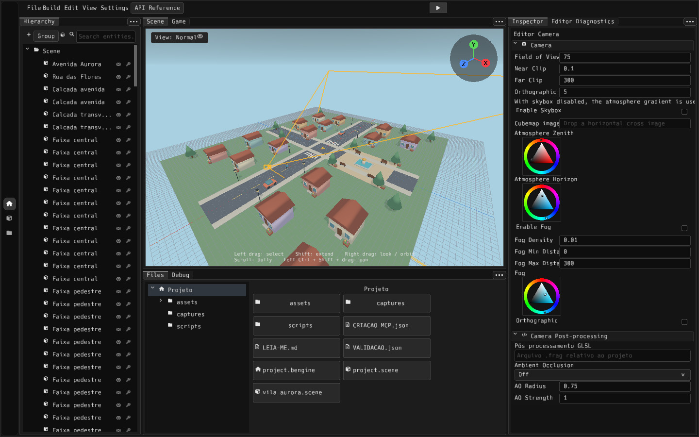
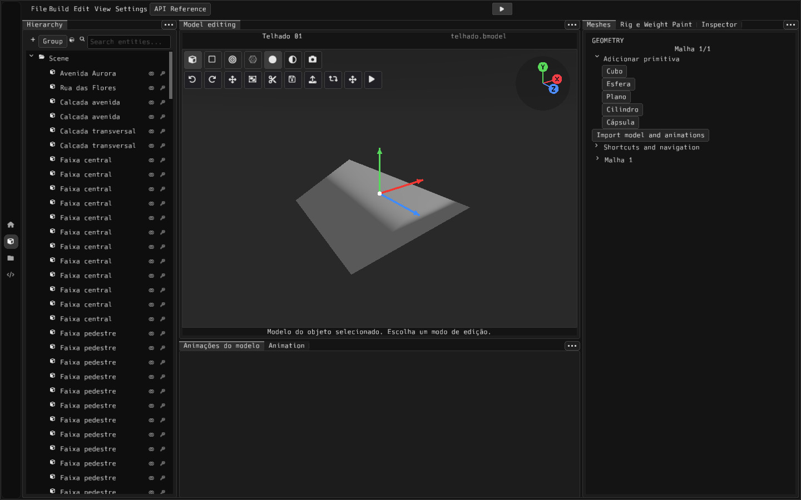
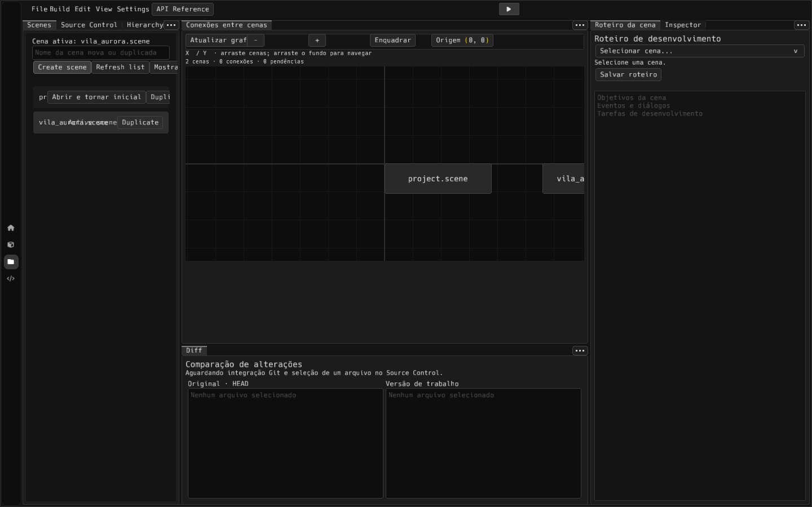
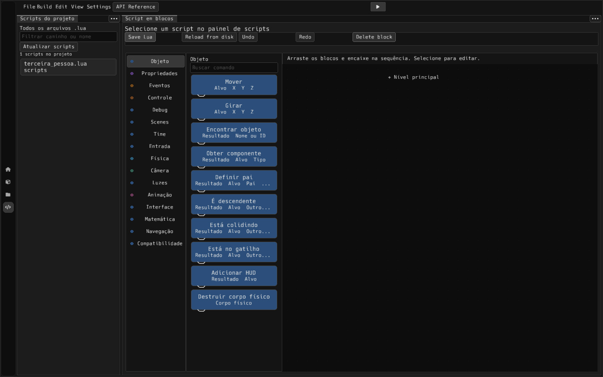

# Bubble Engine

Build a 3D scene, edit its meshes and run the game from one native editor. Bubble Engine pairs a C++20 runtime with Lua scripting and a dockable interface built with [Bubble GUI](https://github.com/D4nielStone/cpp-bgui).

*Vila Aurora in the Scene viewport. The hierarchy lists the town’s entities, including individual roads, houses and crossings.*

## Run the editor

On Linux x86_64, download the **DEB** or **RPM**, install it with your package manager and open **Bubble Engine** from the application menu. To run without installing, extract the **portable ZIP** and open **BubbleEngine.exe** on Windows or **BubbleEngine** on Linux. Releases include engine assets and a precompiled runtime for native folder exports. [Downloads](https://github.com/D4nielStone/cpp-bengine/releases) · [Installation and updates](docs/PORTABLE_RELEASE.md)

Choose **New Project**, start with the empty or first-person template, then press **Play** to run the scene. To compile the engine yourself, see [Building](#building).

| Engine information | Implementation |
| --- | --- |
| Editor and runtime | Native C++20 applications for Linux and Windows |
| Graphics and interface | OpenGL, GLFW and BGUI |
| Gameplay | Entity-component system, Bullet physics and Lua |
| Content | Assimp model import, native meshes, materials and animation clips |
| Project layout | A `project.bengine` manifest points to a separate scene file |
| Local automation | [MCP server](docs/MCP.md) for project and scene tools |

## Editor workspaces

**Modeling** · Select a mesh in the hierarchy to inspect its geometry and materials. Here the roof of a Vila Aurora house is open in the model viewport.

**Scene management** · Inspect the scenes in a project and their connections. The example project contains separate town and project scene files.

**Visual scripting** · Select a Lua script and use the block palette to compose its logic. The screenshot shows the command palette before a script is selected.

## Building

From a checkout with recursive submodules, run `./scripts/build.sh out --test` on Linux or `.\scripts\build.ps1` on Windows. The [build and export guide](docs/BUILDING.md) covers native builds, runtime templates and command-line export.

| Learn more | Guide |
| --- | --- |
| Add behavior to an entity | [Lua API and examples](docs/lua-api/README.md) |
| Animate properties or import a model | [Animation](docs/ANIMATION.md) · [Model import](docs/MODEL_IMPORT.md) |
| Work with multiple scenes | [Scene workflow](docs/SCENE_WORKFLOW.md) |
| Extend the editor | [Editor panels](docs/EDITOR_PANELS.md) |
| Explore engine systems | [Documentation index](docs/README.md) |
