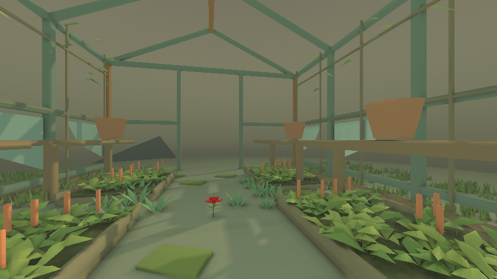
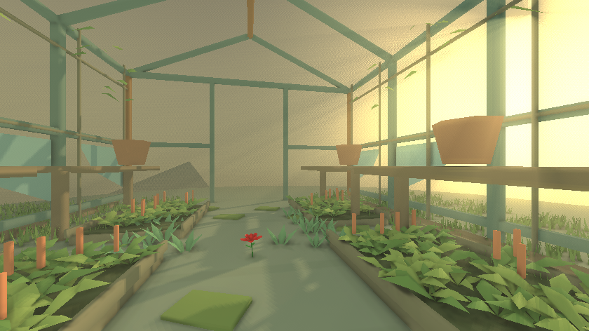
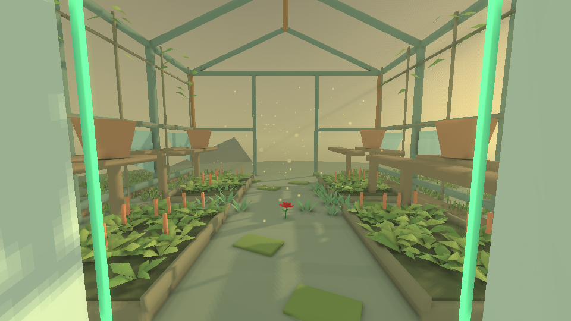

# Efeitos visuais com GLSL e Lua

## Raios solares na neblina

1. Copie `commons/assets/shaders/sun_atmosphere.frag` da engine para
   `assets/shaders/sun_atmosphere.frag` no projeto.
2. Na cena, adicione uma **Directional Light**. Habilite sombras, aqueça a cor
   da luz e aponte-a para dentro da cena. Para começar com a configuração da
   estufa, use direção `(-0.34, -0.36, 0.86)`, intensidade `2.5` e distância
   de sombra `25`. Essa direção descreve o percurso da luz.
3. Coloque geometria que projete sombra entre o sol e o volume. Na estufa, a
   armação do telhado e as esquadrias deixam faixas de luz passar pelas
   aberturas. Habilite **Cast Shadows** nos objetos que devem interromper os feixes.
4. Selecione a câmera de jogo. Em **Camera Post-processing**, atribua
   `assets/shaders/sun_atmosphere.frag` no campo principal. Desative a neblina
   de distância da câmera para usar apenas a composição volumétrica deste guia.
5. Configure `volumeDensity = 0.036`, `volumeHeight = 4.6`,
   `volumeDistance = 30` e `shaftStrength = 0.72`. Ajuste `volumeBase`
   para a altura do chão em coordenadas de mundo. Olhe na direção do sol pela
   câmera de jogo e ajuste a luz e os objetos que projetam sombra.

O shader reconstrói o percurso de cada pixel a partir de `sceneDepth` e
`inverseViewProjection`. Ele integra a densidade até a primeira superfície
opaca ou até `volumeDistance`. Em cada amostra, o mapa de sombras direcional
determina quanta luz direta chega àquele ponto. Aumentar `shaftStrength` torna
visíveis as regiões iluminadas entre as sombras. Aumentar `volumeHeight` faz a
neblina alcançar regiões mais altas.

**Neblina com `shaftStrength = 0`.** A luz direta sobre as superfícies
continua ativa, e a neblina recebe a contribuição ambiente.



**O mesmo enquadramento com `shaftStrength = 1.35`.** A luz solar entra pela
direita. A estrutura interrompe a iluminação do volume.



As duas imagens foram renderizadas na engine com `volumeDensity = 0.064`
e `flareStrength = 0` para isolar a iluminação volumétrica.

## Flare radial, oclusão ambiente e acabamento

| Efeito | Configuração |
|---|---|
| Flare radial | Use o mesmo `sun_atmosphere.frag` em uma câmera em perspectiva. Comece com `flareStrength = 0.22`. A intensidade acompanha a visibilidade da região solar na imagem e diminui perto das bordas. |
| Oclusão ambiente | Selecione **GTAO** na câmera e comece com raio `0.63` e força `0.73`. A engine calcula a máscara usando a profundidade opaca, filtra por profundidade e aplica a oclusão antes do pólen e dos shaders de câmera. |
| Bloom e cor | Copie `commons/assets/shaders/bloom_grade.frag` para o projeto. Coloque `assets/shaders/bloom_grade.frag` em **Passes adicionais em ordem**. Comece com `bloomStrength = 0.35` e `bloomRadius = 4`. O filtro compõe em LDR. |
| Emissão | Copie `emissive.frag` de `commons/assets/shaders` para o projeto. Atribua-o ao material da superfície luminosa e ajuste `emissionColor` e `emissionStrength`. Para iluminar outras superfícies, acrescente uma luz à cena. |
| Fade de abertura | Mantenha o bloom no último passe e anime o próprio `fadeToBlack` dele. O valor `1` produz preto e `0` volta à saída normal do passe. |

Se o sol estiver visível na vista mas o flare estiver ausente, confirme que
sua projeção cai dentro da câmera e que a profundidade deixa a área solar
livre. Para feixes fracos, verifique primeiro a densidade da neblina, a direção
do sol e as sombras na região iluminada. Ajuste a distância de sombra à área
que precisa ser coberta pelo mapa.

## Pólen instanciado e vento

1. Crie um quad no plano XY, centrado na origem, com UVs de `(0, 0)` a
   `(1, 1)`. Use `instanced_particles.vert` e `pollen_additive.frag` como
   shaders do material. Copie ambos de `commons/assets/shaders` para o projeto.
2. Habilite **Additive Particles** no Renderer. Em **Malha 1 → Instâncias**,
   use **Adicionar** para criar pontos do emissor e **Duplicar** para repetir
   a instância selecionada. Navegue com **Anterior**, **Próxima** ou digitando
   o índice. Distribua os pontos pelo volume. Use escala da ordem
   de `0.03` para grãos pequenos e habilite **Local Instances** para mover o
   conjunto com a entidade. A estufa usa 120 instâncias em uma única malha.
3. Ajuste `particleLifetime` em segundos, `particleSpread` para a dispersão
   horizontal, `particleHeight` para o percurso vertical e `opacity` para o
   brilho aparente. Configure **Shader Bounds Padding** para cobrir o
   deslocamento máximo. `softDistance` define a distância em que o grão
   desaparece suavemente junto à geometria.
4. Para vegetação, copie `vegetation_wind.vert` e `pbr.frag` para o projeto e
   combine-os no material. Use instâncias locais para organizar manchas e plante as malhas
   com a base em `y = 0`. Ajuste `windStrength` e `windDirection` no
   material. O vento deforma a parte acima da base e usa a mesma deformação
   na passagem de sombras.

O quad do pólen se orienta para a câmera. O shader calcula a trajetória e a
opacidade sem criar uma entidade para cada grão. O passe aditivo usa a
profundidade opaca para o teste de visibilidade e preserva esse buffer para a
neblina e os raios solares.



## Configuração equivalente em Lua

Anexe o script à entidade da câmera de jogo. Copie os dois shaders de câmera
antes de executar. O trecho configura os passes GLSL. Use o Inspector para
configurar a luz, as sombras e o modo de oclusão.

```lua
function setup()
    local camera = gameObject:GetComponent("Camera")
    if not camera then return end

    camera.postProcessShader = "assets/shaders/sun_atmosphere.frag"
    camera.postProcessPasses = { "assets/shaders/bloom_grade.frag" }

    camera:SetUniform("volumeDensity", "float", 0.036)
    camera:SetUniform("volumeHeight", "float", 4.6)
    camera:SetUniform("volumeDistance", "float", 30.0)
    camera:SetUniform("volumeBase", "float", 0.0)
    camera:SetUniform("volumeTint", "vec3", {0.64, 0.68, 0.54})
    camera:SetUniform("shaftStrength", "float", 0.72)
    camera:SetUniform("flareStrength", "float", 0.22)
    camera:SetUniform("bloomStrength", "float", 0.35)
    camera:SetUniform("bloomRadius", "float", 4.0)
end
```

## Entradas para criar um passe de câmera

| Entrada GLSL | Uso |
|---|---|
| `sceneColor`, `uv`, `viewportSize` | Cor do passe anterior, coordenada normalizada e resolução atual. |
| `sceneDepth`, `hasSceneDepth` | Profundidade opaca compartilhada entre os passes. Consulte a flag antes de amostrar. Profundidade `1.0` representa o fundo. |
| `inverseViewProjection`, `viewProjection` | Reconstrução de mundo e projeção para a tela. |
| `sunDirection`, `sunColor`, `sunIntensity` | Direção de percurso, cor e intensidade da luz direcional ativa. |
| `directionalShadowMap`, `directionalLightSpace`, `hasDirectionalShadow` | Mapa, transformação e disponibilidade da sombra direcional. |

O fragment shader recebe `in vec2 uv` e escreve uma cor `vec4` no
attachment 0. Para preservar pixels quando falta profundidade, devolva
`texture(sceneColor, uv)`. Use a documentação de uniforms para outros
exemplos e tipos aceitos. [Variáveis compartilhadas e shaders GLSL](globals-and-shaders.md)
